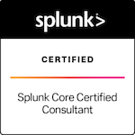

# Hi there, I'm Marquis 

I am a Splunk Consultant, Cribl Engineer and Logging Security Engineer. I build the data pipelines that security depends on, because threat detection is only as good as the data feeding it. Then I use them for detection and automated response. I am passionate about building a secure infrastructure and helping others understand what's happening inside of their system or applications by looking at the data they produce from a Observability point of view.

## Technologies/Skillset

  
  
  
  
  
  
  
  

## What I Do
-Design and build secure, scalable logging platforms for regulated, high-volume environments
-Build telemetry pipelines that route, reduce, and enrich data before it reaches the SIEM
-Automate onboarding, validation, and monitoring so data quality doesn't depend on manual checks

## What I Build
- Scalable Splunk environments (hybrid and cloud) for regulated, high-volume data
- Cribl Stream pipelines that route, reduce, and enrich telemetry
- OpenTelemetry collection standards that give teams one consistent way to ship data
- Cloud security guardrails and auto-remediation for misconfigurations like public S3 exposure and weak IMDS settings

## How I Work
- Data quality first. Detections fail when fields are missing, timestamps drift, or sources go silent. I design pipelines that normalize, enrich, and validate data before it reaches the SIEM.
- Every byte has to earn its place. I cut a Splunk bill by 3x by auditing ingested data for security and operational value, and I treat cost as a design constraint, not an afterthought.
- Detection is engineering. I build detective and preventive controls in AWS and Azure (CloudTrail, EventBridge, Lambda, SCPs, Azure Policy) and treat them like software: versioned, tested, and automated.
- Automate the boring parts. Onboarding, validation, and deployment run through Terraform and CI/CD with security scanning built in, not bolted on.

# 📊 GitHub Stats:
 
 

